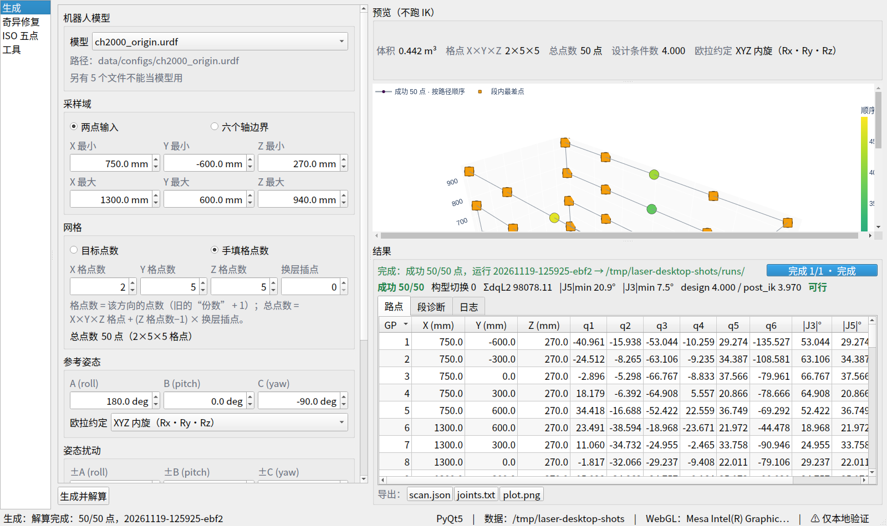
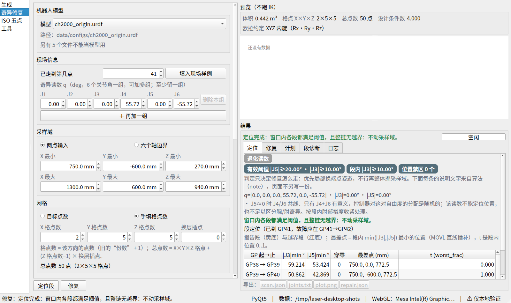
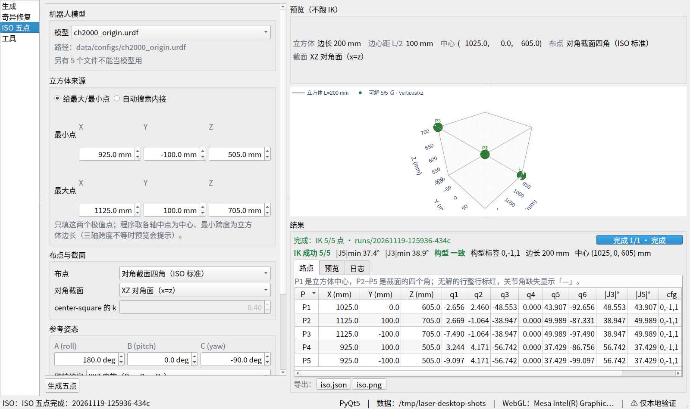
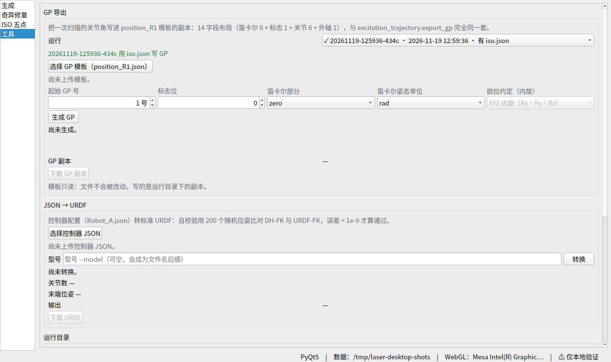

# 操作说明书

> 本说明面向**现场操作人员**，只讲网页界面上怎么点。
> 不需要记命令行、不需要懂算法。
>
> 技术细节（运动学、参数含义、命令行工具）见另一份《开发参考》。

---

## 目录

1. [这个工具能做什么](#一这个工具能做什么)
2. [打开界面](#二打开界面)
3. [桌面版（安装包）](#三桌面版安装包)
4. [界面总览](#四界面总览)
5. [任务一：生成标定点](#五任务一生成标定点)
6. [任务二：现场报奇异，重新出点](#六任务二现场报奇异重新出点)
7. [任务三：生成 ISO 9283 的五个测试点](#七任务三生成-iso-9283-的五个测试点)
8. [任务四：导出控制器 GP 文件](#八任务四导出控制器-gp-文件)
9. [怎么读结果](#九怎么读结果)
10. [常见问题](#十常见问题)
11. [名词解释](#十一名词解释)

---

## 一、这个工具能做什么

| 能做 | 说明 |
| --- | --- |
| 生成标定点 | 在指定的空间范围里，生成若干个姿态各异的点，用于机器人参数标定 |
| 检查点位安全 | 自动检查每个点、以及点与点之间的运动路径上是否会碰到奇异位形 |
| 奇异后重规划 | 现场报警停机时，把停机时的关节角输进去，程序自己判断怎么调整并重新出点 |
| 生成 ISO 9283 五点 | 按国际标准做一个立方体，取 P1～P5 五个测试点 |
| 导出 GP 文件 | 把点位写成控制器能直接导入的 GP 格式 |

它**不会**直接控制机器人：只负责算出点位和文件，实际运动仍由示教器和 JOB 执行。

---

## 二、打开界面

> 这一章讲**用浏览器打开**的方式（维护人员先启服务）。装好的桌面版不用浏览器，见下一章。

1. 请维护人员先把服务启动好（这一步他们会做）；
2. 在本机浏览器打开：

   **http://127.0.0.1:8765**

3. 看到顶部四个标签「生成 / 奇异修复 / ISO 五点 / 工具」即为正常。

> **桌面版（安装包）**：装好后从桌面图标或开始菜单打开「标定路点工具」。
> 界面内容与网页版是同一份代码，但**左侧一列导航**代替了顶部的四个标签，另外还多出一整套
> 安装与许可证的事——这些见下一章 [桌面版（安装包）](#三桌面版安装包)。
> 用浏览器打开的方式仍然保留：没有安装包时临时用，或者维护人员排障时用。

几点说明：

- 这个地址**只能在本机打开**，其它电脑访问不了（有意设计，工具没有登录验证）；
- 如果打不开，先看地址是否完整（`http://` 开头、端口 `8765`）；仍不行请联系维护人员，
  不要自己改配置。

---

## 三、桌面版（安装包）

> 这一章只讲**装出来的那个 Windows 程序**。用浏览器打开的那种用法见上一章。
> 装好之后，表单字段、按钮、结果表格与网页版是同一份代码，逐个字段怎么填见后面各任务章节；
> 本章只讲桌面版**独有**的事：安装、许可证、四个页面、分割条、数据在哪、卸载。



*上图：点「生成并解算」跑完一次 50 点解算之后的样子（左导航 / 表单 / 预览卡 · 3D 图 · 结果表）。*
*截图取自开发机：窗口最下面那行在你的机器上会不一样（绑定名、数据目录、显卡名）。*

### 3.1 安装

1. 拿到安装包：文件名形如 `LaserCalibration-setup-0.9.0.exe`（末尾的数字是版本号）。
2. **双击运行**。首版**没有买代码签名**，Windows 会先拦一下：

   > Windows 已保护你的电脑

   点「**更多信息**」→「**仍要运行**」。这不是安装包坏了，每个版本都会出现。

3. 一路「下一步」装完。**不需要管理员权限**（不会弹 UAC）：程序装在当前用户的
   `C:\Users\<你的用户名>\AppData\Local\Programs\LaserCalibration`。
4. 装完有两个入口：**桌面图标**「标定路点工具」与**开始菜单**里的同名项。
   安装向导里把「创建桌面快捷方式」的勾去掉，就只建开始菜单项。
5. 只支持 **64 位 Windows 10 及以上**；32 位系统与 Windows 7/8.1 装不上
   （界面依赖的 Qt6 与浏览器内核没有对应版本）。

> 装不上时先找安装日志：安装程序会在 `%TEMP%` 下写一份，把它发给维护人员比截图有用。

### 3.2 第一次启动：把许可证放好

桌面版**每次启动都先校验许可证**，通过才开窗口；不通过只弹一个对话框，然后程序退出。

**放哪**

| 放法 | 位置 | 适用 |
| --- | --- | --- |
| 当前用户（首选） | `C:\Users\<你的用户名>\AppData\Local\LaserWaypoint\license.json` | 这台机器只有你一个人用 |
| 整机共用 | `C:\ProgramData\LaserCalibration\license.json` | 多个人用同一台机器 |

不用记路径：**启动失败那一屏会把该放的位置原样写出来**，照着放就行。

**找谁要、怎么申领**

向供应商（签发方）要 `license.json`。许可证按**机器**签发，要带一串「本机网卡指纹」，
所以第一次申领通常是这么走：

1. 先向供应商要一份 `license.json`（说明客户名与机型）；
2. 按上面「放哪」的位置放好，双击程序；
3. 如果那一屏写的是「**本机不是授权绑定的机器**…本机网卡指纹：…」，把这句
   **整句复制**发给供应商（点「详细信息」还有一份逐行的）——他们按这串指纹重签一份；
4. 换上新的一份，再双击一次即可。

> 维护人员也能直接读出这台机器的网卡指纹（程序自带的自检会把物理网卡列出来），
> 拿不到指纹时让他们读一次，比来回试快。

**什么时候要重新签发**

- **换网卡 / 换主板**：指纹变了 → 程序判「本机不是授权绑定的机器」→ 把新指纹发过去重签；
- **到期续期**：有效期写在签名里面，**改系统时间没用**，同样要重签；
- **把安装包拷到别的机器**：那台机器没有证 → 跟第一次装机一样，先给指纹再申领。

**那一屏怎么读**

| 正文写的是 | 意思 | 怎么办 |
| --- | --- | --- |
| 未找到许可证文件…请把…放到 <路径> | 没放、或放错地方 | 按写出来的路径放 `license.json` |
| 本机不是授权绑定的机器…本机网卡指纹：… | 这份证是别的机器的（或换了网卡） | 复制指纹发供应商重签 |
| 许可证已于 YYYY-MM-DD 到期… | 过期了 | 找供应商续签 |
| 程序缺少内置公钥… | 安装包不完整 | 重装；仍不行就要一份完整安装包 |
| 读不到本机的物理网卡… | 虚拟机、或网卡被禁用 | 换实体机；确实只能这样用就联系供应商 |

对话框正文是一句人话，路径、指纹明细、底层原因都在「**详细信息**」里——发问题时连它一起发。

### 3.3 四个页面各做什么

桌面版左侧一列四项（网页版是顶部四个标签，位置不同，内容一样）：

| 左侧项 | 干什么 | 主按钮 |
| --- | --- | --- |
| **生成** | 在采样域里生成 N 个姿态各异的标定点，并解算关节角 | 「生成并解算」 |
| **奇异修复** | 填现场停机读数 → 先定位问题段 → 再重新出点 | 「定位段」→「修复」 |
| **ISO 五点** | 在立方体上取 P1～P5 五个测试点（只出坐标：不给关节角、不加扰动） | 「生成五点」 |
| **工具** | GP 导出、控制器 JSON 转模型、运行记录清理、模板文件摘要 | 「生成 GP」「转换」「清理」 |

三页右边都是同一个结构：**预览卡（上）→ 3D 图（中）→ 结果区（下）**；工具页是一列可滚动的卡片。

生成 / 修复 / ISO 三页的主按钮在**左栏底部**（如「生成并解算」）——它故意不放在滚动区里，窗口再矮也点得到。



*修复页：填「已走到第 41 点」+ 一组停机读数后点「定位段」，判定徽标、阈值、段表都在右侧结果区。*



*ISO 五点页：200 mm 立方体，绿色圆点是算出来的 P1～P5（可达），灰色线框是立方体。*



*工具页：GP 导出（选一次运行 + 选模板 + 填起始 GP 号）；下面依次是 JSON 转模型、运行目录、模板摘要。*

### 3.4 一次完整流程（生成页）

以「在站点范围里生成 50 个点」为例：

1. **选模型**：「机器人模型」下拉选这台机器的型号，下面的「路径」是它在程序里的相对路径。
2. **填采样域**：默认是**两点输入**，填 X/Y/Z 的「最小」与「最大」（单位毫米）；
   也可以切到「六个轴边界」分别填下界与上界。
3. **定点数**：「网格」默认是**手填格点数**，X/Y/Z 各填几个就是几层（如 2 / 5 / 5 = 50 点）；
   想直接要 50 个点就切到「目标点数」填 50，程序自己分配。
4. **看预览卡**：右侧最上面那张卡有五行——**边长 X×Y×Z（米）/ 格点 / 总点数 / 设计条件数 / 欧拉约定**。
   改任何参数它都会立刻重算（不跑解算）；总点数超过 5000 时卡片变红，「生成并解算」直接禁用。
5. **生成**：点左栏底部的「**生成并解算**」。右侧出现进度条与滚动日志，中途可以点「取消」
   （取消在当前阶段末尾生效，不会把正在算的那一段硬切断）。
6. **看结果**：
   - 状态行：`完成：成功 50/50 点，运行 <运行号> → <运行目录>`；
   - 统计卡：`成功 50/50`、`构型切换`、`ΣdqL2`、`|J5|min`、`|J3|min`、
     `design / post_ik`（设计条件数 / 解算后实测）、最后一项是绿的**可行**或红的**不可行**；
   - 3D 图：彩色点是解出来的点（颜色 = 走点顺序，右侧有色条），红色叉是**失败点**；
     鼠标拖动可旋转；
   - 「路点」表：一行一个 GP，**失败行整行标红**；点表头可以排序；
   - 「段诊断」表看相邻两点之间那段路安不安全，「日志」是这一次的完整输出。
7. **导出**：结果区最下面三个按钮——`scan.json` / `joints.txt` / `plot.png`。
   点一下选保存位置，程序**复制**一份出来（运行目录里的原件不动），默认文件名前面带运行号。

> 桌面版改任何一个参数都会**自动重画**预览图，所以没有网页版那个「预览路点」按钮：
> 要看点位分布，直接看右上方的图就行（预览图只有点，不带关节角，要关节角必须「生成并解算」）。

### 3.5 看到「不可行」怎么办

「不可行」不是程序出错，是**这批点不满足安全判据**。它会同时出现在两处：

- 统计卡最后一项：红色「不可行」；
- 状态行：`完成（不可行）：…`，并另起一行 `原因：…`。

「原因」后面是程序给出的具体说明（多条用「；」连起来），常见的几种：

| 原因里写着 | 意思 | 怎么调 |
| --- | --- | --- |
| 姿态激励条件数未达标：门禁 X > 阈值 Y | 这批点的姿态差异不够，标定出来的参数不可信 | 换参考姿态 A/B/C，或按维护人员的建议改「扰动半宽」；预览卡里的「设计条件数」能提前看到 |
| N 个路点无解 | 有些点这台机器到不了 | 缩小采样域，或把参考姿态换成现场常用的姿态 |
| 段内奇异：J3 穿 0 的段 N 处… | 两点之间的**路径**经过奇异（端点安全也没用） | 缩小采样域或改姿态，让相邻点不再跨过奇异面 |
| 重采后仍低于奇异阈值：… | 程序试过微调姿态，还是离奇异太近 | 把采样域挪离奇异区；想放宽 `\|J5\|` 下限先问维护人员 |

两条补充（都是实测口径）：

- **判「不可行」的条件是四条全部满足**：每个点都有解、守卫重采后不再低于阈值、段内不穿零、
  条件数不被拒。所以「成功 50/50」也可能仍然不可行——那通常是最后一条（条件数被拒）。
- **点数多少本身不进判据**。预览卡里的「设计条件数」只由**参考姿态 + 三个扰动半宽**决定：
  同样填扰动 20 / 20 / 35，参考姿态填 `3 / 73 / -167` 算出来是 7.81，填 `180 / 0 / -90`
  就只有 1.75（上限默认 9）。拿不准时先看预览卡再点生成。

### 3.6 拖分割条

窗口里有三处可以拖，**拖过的比例与宽度会记住**（关掉程序再开还是那个样子）：

| 拖哪里 | 作用 |
| --- | --- |
| 最左边「生成 / 奇异修复 / ISO 五点 / 工具」那一列 与 表单 之间 | 导航列宽度（往右拖得宽，往左拖到“字不被切”为止，不切回不了别的页） |
| 左栏表单 与 右栏结果 之间那条**竖直**的缝 | 表单拖窄 / 拖宽（右边三段跟着一起变宽） |
| 右栏「预览卡 / 3D 图 / 结果区」之间的**两道横缝** | 三段各分多少高度（把结果区拉高，一屏能多看几行表） |

几条实测出来的规矩：

- 表单列拖不成一条缝：到表单自己需要的最小宽度就顶住了，数值框不会被裁掉；
- 导航列的下限是“最长一项不被切字”的宽度；换到字号/缩放比不同的机器上，存过的宽度比下限还小就自动按下限算；
- 出结果时结果区会**自己撑高**到能看 8 行：先向图区借（图不低于 200 px），不够再向预览卡借；
- 你把它拖大之后，程序不会再把它缩回去；拖过之后也不再因为“保图区高度”去改你的比例；
- 「一屏 5 行」是默认布局的保底；想看更多行，把结果区往上拖；
- 换到更小的窗口、存下来的宽度装不下时，左右两栏自动回到默认比例。

> 缝很窄（几个像素）。鼠标移上去会变成左右或上下箭头，那时再按住拖。

### 3.7 数据在哪、怎么清理

程序**不需要联网**：模型、图、模板都在本机。跑出来的东西也都在本机：

| 东西 | 位置 |
| --- | --- |
| 每次运行的产物 | `C:\Users\<你的用户名>\AppData\Local\LaserWaypoint\runs\<运行号>\` |
| 图表缓存 | `C:\Users\<你的用户名>\AppData\Local\LaserWaypoint\.cache\` |
| 窗口布局与分割比例 | 注册表 `HKEY_CURRENT_USER\Software\robot-calibration\laser-desktop` |

窗口最下面一行**右侧**常驻写着「数据：…」，那就是用户数据目录（把鼠标停在这行字上会显示完整路径）。

一次运行一个目录，里面是：

| 哪一页 | 目录里的文件 |
| --- | --- |
| 生成 | `scan.json`（完整结果）、`joints.txt`（每行 6 个关节角）、`plot.png`（3D 图） |
| 奇异修复 | 同样三样，外加 `repair.json`（定位与修复的判定过程） |
| ISO 五点 | `iso.json`（每点的 X/Y/Z + 参考姿态）、`iso.png`（五点图） |

**自动保留最近 50 次**：超过就删最旧的（正在跑的那一次不会删）。想手动清：

1. 左侧「工具」→ 最下面的「**运行目录**」，卡片开头写着「共 N 个运行目录」；
2. 点「**清理（保留最近 50）**」→ 状态行写「已删除 N 个运行目录，保留最近 M 个」；
3. 「刷新」只重新读列表，不删东西。

**卸载时会不会删掉这些？** 会**问**一句，默认**不删**（见下一节）。

### 3.8 卸载

1. Windows「设置 → 应用 → 安装的应用」里找「**标定路点工具**」，或者开始菜单里的
   「卸载 标定路点工具」；
2. 卸载完会问一句：「是否同时删除运行记录与图表缓存？」**默认是「否」**：
   - 选「否」：运行记录与缓存都留着，重装后还能看到以前的解算结果（会占磁盘）；
   - 选「是」：连运行记录、图表缓存一起删掉，**删了就找不回来**；
3. 脚本静默卸载时不会问，也**不删**这些数据（避免自动化部署把现场结果一起抹掉）。

程序本体装在 `C:\Users\<你的用户名>\AppData\Local\Programs\LaserCalibration`，
卸载时整个目录一起删掉；只有上面那两个数据目录要你自己决定。窗口布局那个注册表键会一并清理。

---

## 四、界面总览

> 下面的示意图是**网页版**的布局：顶部四个标签。桌面版把顶部标签换成了**左侧一列**，
> 其余（左表单 / 右结果）完全一样；桌面版独有的东西都在上一章。

```
┌────────────────────────────────────────────┐
│ 生成 │ 奇异修复 │ ISO 五点 │ 工具           │  ← 四个标签
├──────────────┬─────────────────────────────┤
│              │                             │
│   左侧：表单  │   右侧：结果                 │
│   填参数      │   统计、3D 图、表格、下载     │
│              │                             │
└──────────────┴─────────────────────────────┘
```

通用操作习惯：

- 左侧改任何参数，右侧的「预览」数字会**立刻跟着变**（不会真的去算，所以很快）；
- 一个页面一次只跑一件事；跑的过程中可以点「取消」；
- 页面刷新或切走再回来，正在跑的任务会被自动接回来，不用重跑。

---

## 五、任务一：生成标定点

最常见的一件事：在一个空间范围里生成 50 个点。

### 第 1 步：选机器人模型

左侧最上方「机器人模型」下拉，选当前这台机器的型号（一般就是列表里第一个能选的）。

> 下拉里只出现**可用的**模型。如果你需要的那台不在列表里，展开下面的
> 「另有 N 个文件不能当模型用」看原因，并把情况告诉维护人员。

### 第 2 步：填采样范围

「采样域」有两种填法，二选一（用切换按钮）：

| 方式 | 怎么填 |
| --- | --- |
| **两点输入** | 填「最小点」和「最大点」的 X/Y/Z 三个坐标——就是作业空间的一个对角 |
| **六个轴边界** | 分别填 X/Y/Z 的下界与上界 |

单位是**毫米**。填完右侧「预览」会显示盒子三边长度（米），例如 `0.550 × 1.200 × 0.670 m`。

### 第 3 步：决定点数量

「网格」也有两种，二选一：

| 方式 | 怎么用 |
| --- | --- |
| **目标点数**（推荐） | 直接填 50，程序自己分配 X/Y/Z 各几格，正好 50 个点 |
| **手填份数** | 自己填 X/Y/Z 三个方向的**格点数**（就是这一方向有几个点，如 4 表示 4 个），还可在层间插点 |

> 「预览」里会显示这次的「格点 X×Y×Z」与「点数」——直接对数就能估：
> 格点 2×5×5 = 50 点。
> 如果点数超过 5000，卡片会**变红并禁止生成**——那是防止手滑把份数填成几百。

### 第 4 步：填参考姿态

「参考姿态 A/B/C」三个数字，单位是**度**，就是这批点大致要摆的姿态（例如焊接姿态）。
右侧「欧拉约定」保持默认的 **XYZ 内旋** 即可，除非维护人员另有交代。

### 第 5 步：姿态扰动幅度

「扰动半宽」三个数字（度），表示每个点在这个范围内随机微调姿态，让各点姿态有差异。
常用 20 / 20 / 35。下面的 `seed` 保持不动（填 0），它能保证同样的参数每次结果一致。

### 第 6 步：安全阈值

| 字段 | 作用 | 常用值 |
| --- | --- | --- |
| `\|J5\| 下限` | 5 轴离奇异的最小角度，太小会报警 | 20 |
| `\|J3\| 下限` | 3 轴的最小角度（0 表示不检查） | 0 |
| `段内下限` | 两点之间运动过程中允许的最小角度 | 5 |
| `条件数上限` | 姿态差异是否足够大到能标定出参数 | 9 |
| `段模型` | 点位之间怎么走：`MOVL` 直线 / `PTP` 关节 | 保持 **MOVL** |
| `q-seed` | 计算起始姿态，影响选哪一组关节解 | 按维护人员给的填 |

> 不知道填什么时，**保持默认值**，只改采样范围和目标点数即可。

### 第 7 步：生成

- 只想先看看点在哪：点「**预览路点**」（快，只出图不算关节）；
- 要能用的数据：点「**生成并解算**」。

跑的时候右侧会出现进度条和滚动的日志，随时可以「取消」。

### 第 8 步：看结果、下载文件

跑完右侧会出现：

| 区块 | 看什么 |
| --- | --- |
| **统计卡** | 「成功 50/50」= 全部点都能算出来；「构型」是否一致；「可行」是否绿色 |
| **3D 图** | 鼠标拖动可旋转。灰蓝色点是正常点，**红色叉是失败点** |
| **路点表** | 每个点的坐标、六个关节角、裕度；失败行整行标红 |
| **段诊断** | 每两点之间那段路是否安全，穿零就是有问题 |
| **导出** | 三个按钮，见下 |

三个文件：

| 文件 | 用途 |
| --- | --- |
| `scan.json` | 完整结果，给「工具」页导 GP 用，也给维护人员留档 |
| `joints.txt` | 每行 6 个关节角（度，空格分隔，3 位小数） |
| `plot.png` | 3D 图，可直接贴进报告 |

---

## 六、任务二：现场报奇异，重新出点

### 第 1 步：记下现场信息

机器人报奇异停住时，记两样东西：

1. **已走到第几点**（示教器上看当前执行到哪个点位，大约的也行）；
2. **停住时的 6 个关节角**（示教器位置页面能看到）。

### 第 2 步：填进「奇异修复」页

- 「已走到」填第 1 样；
- 「奇异关节角」填第 2 样的六个数（多个数之间用空格隔开）；
- 如果停机不止一次，点「+」再加一组；
- 下面的采样域、姿态、安全阈值，**和第一次生成时填的一样**。

### 第 3 步：先定位

点「**定位段**」。右侧会出现：

- 一个判定徽标：`退化读数` / `腕奇异` / `肘奇异` / `判据外位形`；
- 一张段表：报告点前后的每一段，`|J3|min`、`|J5|min`、是否穿零、最差点坐标。

判读要点：

| 看到什么 | 含义 | 下一步 |
| --- | --- | --- |
| 「窗口内各段都满足阈值，且整链无越界」 | 模型算不出这次报警 | 核对点号是否记错；把判定徽标内容告诉维护人员 |
| 某一段标红（穿零或裕度不足） | 那一段是问题所在 | 点「修复」 |

### 第 4 步：修复

点「**修复**」。程序按两步走：

1. 先只微调**问题点那一段的姿态**（位置完全不动，最省事）；
2. 上一步不行，再整体微调采样范围（平移或收缩）。

右侧会给出「修复前 / 修复后」对照：改了哪个点、边界怎么变、采样域缩小了多少、关键指标前后对比。
最后一栏是修复后的计划（统计卡 + 3D 图 + 路点表），可以导出。

> 如果提示「所有候选都不可行」：说明按当前姿态和安全阈值确实出不了安全的点。
> 把截图发给维护人员，通常会放宽姿态或调整范围。

---

## 七、任务三：生成 ISO 9283 的五个测试点

用于做定位精度测试。这一页只出 **5 个点**（P1～P5），五个点姿态完全相同。

### 第 1 步：选机器人模型

同上。

### 第 2 步：填立方体

只填**两个极值点**，别的不填：

| 填什么 | 怎么填 |
| --- | --- |
| **最小点** | 立方体靠近工作空间下限那一角的 X / Y / Z |
| **最大点** | 对角那一角的 X / Y / Z |

程序取两点的中点为立方体中心、取三个方向里**最小跨度**为边长。

> 三轴跨度差很多时，程序会提示"取最小跨度为边长"。想精确控制立方体大小，
> 就让三个方向的跨度一样。

> 五个测试点由程序从这个立方体算出来，不需要逐个输入：**P1 是立方体中心**，
> **P2～P5 是立方体对角截面（XZ 对角面）的四个角**。

五点的编号是 ISO 9283 规定的，按这个顺序核对：

| 点 | 位置 |
| --- | --- |
| P1 | 立方体中心 |
| P2、P3 | **X 小、Z 小** 那一侧（两点的 X、Z 都比中心小） |
| P4、P5 | **X 大、Z 大** 那一侧（两点的 X、Z 都比中心大） |

同一侧的两个点只差在 Y（一个 Y 为正、一个 Y 为负）。

### 第 3 步：填姿态

五个点共用同一个姿态。填 A/B/C（度），欧拉约定用默认「XYZ 内旋」。

### 第 4 步：生成

点「**生成五点**」。马上出结果（只算坐标，不用等）。

这一页**只算坐标**：姿态固定为你上面填的参考姿态、不加扰动；程序会解一次
运动学来判断每个点**够不够得到**，但**不显示、也不导出关节角**。

### 第 5 步：看结果、导出

- 统计行：**可达 5/5**、边长、中心；不到 5/5 时这一行是红字；
- 3D 图：灰色框是立方体，绿点是可达的点、红叉是不可达的点（鼠标悬停只看
  点名与 X/Y/Z）；
- 五点表：每个点的 X/Y/Z 与「可达 / 不可达」，不可达的整行标红；
  每行右侧写着它在立方体的哪一侧，可以直接按 P1 中心 / P2、P3 小 X 小 Z /
  P4、P5 大 X 大 Z 核对；
- 「预览」页签：6 个面心、9 个候选点（8 个顶点 + 中心）、最终 5 点的坐标。

导出 `iso.json`（每点的 X/Y/Z + 参考姿态，没有关节角）和 `iso.png`（图）。
文件在你点导出时才生成；`iso.json` 里没有关节角，所以**不能**拿去导 GP——
要导 GP 请用「生成」页的结果。

> 有不可达的点：缩小立方体（把最小点往中间挪、最大点往中间挪）或换参考姿态。

> 现场执行时这五个点要按 **MOVL（直线）** 依次走，不要用 PTP，否则实际路径会变、测试结果不作数。

---

## 八、任务四：导出控制器 GP 文件

1. 打开「**工具**」页，第一张卡片「GP 导出」；
2. 「运行」下拉里选刚才那次结果（右侧标 `有 scan.json` 的才是可用的）；
3. 「上传 GP 模板」：选控制器现成的 `position_R1.json`（或维护人员给的模板文件）；
4. 起始 GP 号一般填 `1`；其它选项保持默认（标志位 0、笛卡尔部分 `zero`、单位 `rad`、欧拉 `XYZ 内旋`）；
5. 点「**生成 GP**」→ 显示"已写入 50 个 GP"→ 点下载。

注意：

- **模板只读**：程序不会改你上传的那个文件，写的是副本；
- 模板里的控制器 ID 与版本号原样保留；
- 导入控制器前，**先在示教器抽查一个 GP 回读的关节值**，确认无误再整体导入。

同一页还有两个小功能：

| 卡片 | 用途 |
| --- | --- |
| JSON → URDF | 把控制器配置文件转成模型文件，一般由维护人员用 |
| 运行目录 | 列出历史运行记录，可一键清理（保留最近 50 次） |

---

## 九、怎么读结果

| 指标 | 含义 | 什么样算好 |
| --- | --- | --- |
| **成功 n/N** | 有多少点算出了关节解 | `N/N` 全成功 |
| **构型** | 所有点是否用同一组"臂型"（肘上/肘下等） | 「一致」；不一致会导致运动中甩臂 |
| **构型切换** | 相邻点之间换了臂型的次数 | `0` |
| **ΣdqL2** | 相邻点关节变化量累加，粗略反映运动总量 | 只用于同参数下横向比较 |
| **\|J5\|min** | 所有点里 5 轴离奇异最近的角度（度） | 不小于阈值（默认 20°） |
| **\|J3\|min** | 3 轴离奇异最近的角度 | 大于 0 |
| **段内穿零** | 两点之间运动过程中某轴是否穿过 0 | 必须为 `0` |
| **条件数**（设计值 / 解算后） | 姿态差异是否足够大，越小越好标定 | 不超过阈值（默认 9） |
| **可行** | 上面这些是否全部满足 | 绿色「可行」 |

红色一律代表"这里有问题"，优先处理标红的那一行。

---

## 十、常见问题

| 现象 | 怎么办 |
| --- | --- |
| 浏览器打不开 8765 | 确认地址是 `http://127.0.0.1:8765`；仍不行找维护人员启动服务 |
| 改参数后右侧数字不变 | 先刷新页面（F5）再试；仍不变请把情况告诉维护人员 |
| 模型下拉里没有我要的机器 | 展开下面的「另有 N 个文件不能当模型用」看原因，反馈给维护人员 |
| 点「生成并解算」按钮是灰的 | 说明当前点数超过 5000，改小份数或改用「目标点数」 |
| 统计卡「成功 49/50」 | 有一个点无解，优先缩小采样范围或换参考姿态 |
| 3D 图里有红色叉 | 那一点算不出解，同上处理 |
| 段诊断里出现「穿零」 | 那一段路运动时会经过奇异，需要调整范围或姿态 |
| 「修复」提示所有候选不可行 | 按当前姿态/阈值确实无安全解，联系维护人员放宽条件 |
| 下载按钮点了没反应 | 该文件已被清理（历史只保留最近 50 次），重新跑一次即可 |
| 界面显示「已取消」 | 是你自己点了取消；点「生成并解算」重跑 |

---

## 十一、名词解释

| 词 | 意思 |
| --- | --- |
| **路点 / 标定点** | 机器人要去的某一个位置 + 姿态 |
| **采样域（AABB）** | 一个长方体空间范围，点就在这里面取 |
| **网格 2×5×5** | 空间被分成 2×5×5 层格点，全部取到就是 50 个点 |
| **构型（臂型）** | 同一位置可能有多种关节组合（肘上/肘下、腕翻转），构型不一致会导致运动中大幅甩臂 |
| **奇异 / 奇异位形** | 机器人某几个轴"排成一条线"时的姿态，此时运动学退化、控制器容易报警停机 |
| **\|J5\| / \|J3\|** | 第 5 轴 / 第 3 轴的角度绝对值，越小越接近奇异 |
| **关节角** | 六个轴各自的转角（度） |
| **参考姿态 A/B/C** | 这批点大致要摆的姿态，用三个角表示（度） |
| **姿态扰动** | 在参考姿态附近随机微调，让各点姿态有差异 |
| **MOVL / PTP** | 两种走点方式：直线走 / 关节按比例走。两者实际路径不同 |
| **GP** | 控制器里存点位的一套寄存器，本工具导出的就是它 |
| **ISO 9283** | 机器人性能测试的国际标准；其中定位精度测试用立方体内的 5 个点 |
| **内旋** | 姿态角的一种读法（先转的轴跟着转）。本工具只有这一种，下拉里显示「XYZ 内旋」等 |
